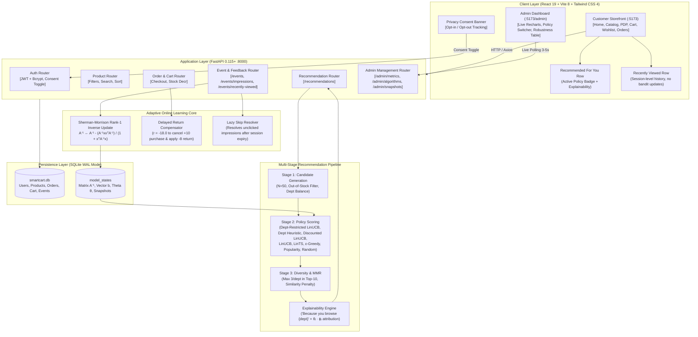

# SmartCart AI — Adaptive E-Commerce Platform with Contextual Multi-Armed Bandits

[](https://fastapi.tiangolo.com)
[](https://react.dev)
[](https://vitejs.dev)
[](https://tailwindcss.com)
[](https://sqlite.org)
[](https://python.org)
[](backend/tests)
[](LICENSE)

SmartCart AI is a fully tested, verified, multi-category e-commerce web application featuring an adaptive recommendation engine powered by **Contextual Multi-Armed Bandits (LinUCB with Sherman-Morrison rank-1 updates)** and **Two-Stage Hybrid Policies**. Designed to mirror enterprise e-commerce platforms like Amazon and Flipkart, it operates with Indian Rupee (₹) currency and supports six core retail departments: **Electronics, Fashion, Home & Kitchen, Beauty, Sports & Fitness, and Books** (262 active catalog SKUs: 157 DummyJSON + 105 seeded Books).

The platform provides nine admin-switchable policies (default: **Dept-Restricted LinUCB** with $m=2$ exploration slots), transparent explainability ("Because you browse {department} • {feature_reason}"), dedicated storefront rows ("Recommended For You" and "Recently Viewed"), and sub-millisecond online parameter updates ($<0.3\text{ ms}$).

---

## Table of Contents

1. [Overview & Problem Statement](#1-overview--problem-statement)
2. [End-to-End System Architecture](#2-end-to-end-system-architecture)
   - [2.1 Data Sources & Catalog Differentiation](#21-data-sources--catalog-differentiation)
3. [36-Dimensional Context Feature Vector](#3-36-dimensional-context-feature-vector)
4. [Bandit Recommendation Algorithms & Robustness](#4-bandit-recommendation-algorithms--robustness)
5. [Reward Function & Delayed Feedback Handling](#5-reward-function--delayed-feedback-handling)
6. [Quick Start & Running Instructions](#6-quick-start--running-instructions)
7. [Comprehensive API Reference](#7-comprehensive-api-reference)
8. [Admin Dashboard & Simulation Suite](#8-admin-dashboard--simulation-suite)
9. [Empirical Benchmark Results & Offline Evaluation](#9-empirical-benchmark-results--offline-evaluation)
   - [9.1 Calibrated Simulator v2 Benchmark Results](#91-calibrated-simulator-v2-benchmark-results-phase-12a-2-authoritative)
   - [9.2 Offline Evaluation & Research Findings (Retailrocket — Frozen)](#92-offline-evaluation--research-findings-retailrocket--permanently-frozen)
10. [Assumptions & System Limitations](#10-assumptions--system-limitations)
11. [Future Roadmap](#11-future-roadmap)

---

## 1. Overview & Problem Statement

### The Dilemma in Modern E-Commerce Recommendations

Traditional recommendation engines rely heavily on **Collaborative Filtering (Matrix Factorization)** and **Deep Neural Networks (Two-Tower models)** trained in offline batch pipelines. While effective for static catalogs, these architectures suffer from fundamental limitations in dynamic retail environments:

1. **Feedback Loops & Popularity Traps**: Popular products receive impressions, which generate clicks, which in turn feed training data that tells the model to recommend those products even more. High-margin or emerging products are starved of traffic.
2. **Exploration vs. Exploitation Trade-off**: Pure exploitation recommends items with high historical conversion rates, maximizing immediate revenue but preventing the discovery of evolving customer preferences. Pure exploration introduces irrelevant products that alienate shoppers.
3. **The Cold-Start Challenge**: New visitors have no historical profile, and newly cataloged items have zero ratings. Collaborative filtering collapses when interaction matrices are sparse.
4. **Preference Drift**: Shoppers' preferences change over time (e.g., seasonal holidays, life stage changes, technology upgrades). Offline models cannot adapt until the next retraining cycle.

### The SmartCart AI Solution

SmartCart AI formulates recommendation as an **online Contextual Multi-Armed Bandit (MAB)** problem with multi-stage ranking:

```
At each interaction round t:
1. Context Extraction: The system observes user context and candidate product features ϕ(u, p) ∈ ℝ³⁶.
2. Candidate Generation: 50 candidate products are selected using category balance and inventory rules.
3. Policy Scoring: The active policy (default: Dept-Restricted LinUCB) scores candidates. Stage 1 identifies
   the dominant browsed department; Stage 2 solves LinUCB within that department, reserving m exploration slots
   for catalog-wide discovery.
4. Diversity & MMR Re-Ranking: Maximal Marginal Relevance limits category dominance (max 3 per department).
5. Explainability: Transparent feature attributions (θᵢ · ϕᵢ) generate human-readable recommendation reasons
   (e.g., "Because you browse Electronics • High customer rating"). Exploration picks are explicitly badged.
6. Real-Time Feedback Loop: User actions (click, add-to-cart, purchase, dislike, return) emit scalar rewards.
7. Online Update: Bandit parameter vectors are updated in-memory via O(d²) Sherman-Morrison rank-1 matrix updates.
```

---

## 2. End-to-End System Architecture



### 2.1 Data Sources & Catalog Differentiation

SmartCart AI maintains a strict, documented separation between its live application catalog and offline benchmark datasets:

| Dataset / Scope | Entity Count & Source | Role in System | Warm-Start & Isolation |
| :--- | :--- | :--- | :--- |
| **Storefront Catalog (Live System)** | **262 SKUs** across 6 departments (157 items from DummyJSON API + 105 realistic seeded Books). Currency: INR (₹). | Powers live storefront browsing, shopping cart, checkout, and live recommendation rows. | Seeded into `smartcart.db`. Completely isolated from offline research data. |
| **Retailrocket Research Dataset (Offline Only)** | **335,612 test interactions** across 194,155 visitors (263,849 novel targets, 71,763 repeat targets). | Used strictly for offline proxy replay and prequential learning evaluation under frozen Phase 10D protocol. | **`warm_start: OFF`** in live models. Kept strictly backend-only; never contaminates live shopper sessions. |
| **Calibrated Simulator v2 Environment** | **262 active catalog SKUs**, $d=36$ feature space, 4 environment variants (Base, Hidden Style, Nonlinear, High Funnel). | Rigorous synthetic benchmark over 20,000 rounds across 30 paired seeds (Common Random Numbers). | Synthetic ground-truth user preferences; operates entirely within `experiments/sim_v2/`. |


---

## 3. 36-Dimensional Context Feature Vector

Every recommendation decision evaluates a joint user-item context vector $\phi(u, p) \in \mathbb{R}^{36}$. The feature vector incorporates customer preference decays, product attributes, cross-term interactions, and temporal cyclicality.

| Index | Feature Name | Data Type | Range | Description & Rationale |
| :---: | :--- | :---: | :---: | :--- |
| **0** | `user_aff_electronics` | Float | $[0.0, 1.0]$ | Exponentially time-decayed interaction weight with Electronics ($\lambda = 0.05/\text{day}$). |
| **1** | `user_aff_fashion` | Float | $[0.0, 1.0]$ | Exponentially time-decayed interaction weight with Fashion products. |
| **2** | `user_aff_home_kitchen` | Float | $[0.0, 1.0]$ | Exponentially time-decayed interaction weight with Home & Kitchen products. |
| **3** | `user_aff_beauty` | Float | $[0.0, 1.0]$ | Exponentially time-decayed interaction weight with Beauty & Personal Care. |
| **4** | `user_aff_sports` | Float | $[0.0, 1.0]$ | Exponentially time-decayed interaction weight with Sports & Fitness equipment. |
| **5** | `user_aff_books` | Float | $[0.0, 1.0]$ | Exponentially time-decayed interaction weight with Books & Publications. |
| **6** | `prod_cat_electronics` | Binary | $\{0, 1\}$ | One-hot indicator: Product is in Electronics department. |
| **7** | `prod_cat_fashion` | Binary | $\{0, 1\}$ | One-hot indicator: Product is in Fashion department. |
| **8** | `prod_cat_home_kitchen` | Binary | $\{0, 1\}$ | One-hot indicator: Product is in Home & Kitchen department. |
| **9** | `prod_cat_beauty` | Binary | $\{0, 1\}$ | One-hot indicator: Product is in Beauty department. |
| **10** | `prod_cat_sports` | Binary | $\{0, 1\}$ | One-hot indicator: Product is in Sports department. |
| **11** | `prod_cat_books` | Binary | $\{0, 1\}$ | One-hot indicator: Product is in Books department. |
| **12** | `price_ratio` | Float | $[0.0, 2.0]$ | Ratio of product price to department maximum price: $\min(2.0, p / p_{\text{max\_dept}})$. |
| **13** | `discount_pct_norm` | Float | $[0.0, 1.0]$ | Normalized promotional discount percentage: $\text{discount} / 100.0$. |
| **14** | `rating_norm` | Float | $[0.0, 1.0]$ | Normalized customer rating: $\text{rating} / 5.0$. |
| **15** | `log_review_count` | Float | $[0.0, 1.0]$ | Log-transformed social proof: $\ln(1 + \text{reviews}) / \ln(10001)$. |
| **16** | `popularity_score` | Float | $[0.0, 1.0]$ | Normalised catalogue-wide sales popularity rank. |
| **17** | `in_stock_factor` | Float | $[0.0, 1.0]$ | Logistic stock factor: $\min(1.0, \text{stock} / 20.0)$. |
| **18** | `user_price_sensitivity`| Float | $[0.0, 1.0]$ | Customer's historical mean purchase price relative to catalog range. |
| **19** | `user_discount_pref` | Float | $[0.0, 1.0]$ | Customer's historical affinity for discounted purchases. |
| **20** | `user_return_tendency` | Float | $[0.0, 1.0]$ | Fraction of customer's historical orders that resulted in a return. |
| **21** | `category_match` | Float | $[0.0, 1.0]$ | Direct dot product of user affinity vector and item category one-hot vector. |
| **22** | `price_affinity_match` | Float | $[0.0, 1.0]$ | Price compatibility score: $1.0 - |\text{price\_ratio} - \text{user\_price\_sensitivity}|$. |
| **23** | `rating_credibility` | Float | $[0.0, 1.0]$ | Composite rating reliability: $\text{rating\_norm} \times \text{log\_review\_count}$. |
| **24** | `day_of_week_sin` | Float | $[-1.0, 1.0]$ | Cyclical temporal feature: $\sin(2\pi \cdot \text{weekday} / 7)$. |
| **25** | `day_of_week_cos` | Float | $[-1.0, 1.0]$ | Cyclical temporal feature: $\cos(2\pi \cdot \text{weekday} / 7)$. |
| **26** | `hour_of_day_sin` | Float | $[-1.0, 1.0]$ | Cyclical temporal feature: $\sin(2\pi \cdot \text{hour} / 24)$. |
| **27** | `hour_of_day_cos` | Float | $[-1.0, 1.0]$ | Cyclical temporal feature: $\cos(2\pi \cdot \text{hour} / 24)$. |
| **28** | `is_weekend` | Binary | $\{0, 1\}$ | Binary weekend indicator: $1$ if Saturday or Sunday, else $0$. |
| **29** | `interact_electronics` | Float | $[0.0, 1.0]$ | Second-order interaction: `user_aff_electronics` $\times$ `prod_cat_electronics`. |
| **30** | `interact_fashion` | Float | $[0.0, 1.0]$ | Second-order interaction: `user_aff_fashion` $\times$ `prod_cat_fashion`. |
| **31** | `interact_home_kitchen`| Float | $[0.0, 1.0]$ | Second-order interaction: `user_aff_home_kitchen` $\times$ `prod_cat_home_kitchen`. |
| **32** | `interact_beauty` | Float | $[0.0, 1.0]$ | Second-order interaction: `user_aff_beauty` $\times$ `prod_cat_beauty`. |
| **33** | `interact_sports` | Float | $[0.0, 1.0]$ | Second-order interaction: `user_aff_sports` $\times$ `prod_cat_sports`. |
| **34** | `interact_books` | Float | $[0.0, 1.0]$ | Second-order interaction: `user_aff_books` $\times$ `prod_cat_books`. |
| **35** | `bias_intercept` | Constant | $1.0$ | Constant unit bias term for linear regression. |

---

## 4. Bandit Recommendation Algorithms & Robustness

SmartCart AI includes nine fully implemented recommendation policies conforming to the unified `BaseRecommender` interface (`backend/app/recommender/base.py`). All models are switchable in real time via the Admin Dashboard or `POST /admin/algorithms`.

### 4.1 Dept-Restricted LinUCB (Two-Stage Hybrid — Default Policy)

The default recommendation algorithm is **Dept-Restricted LinUCB** (`dept_restricted_linucb`), a two-stage hybrid combining fast heuristic department routing with contextual exploration:

1. **Stage 1 (Dominant Department Identification)**: Evaluates observable customer event history in the current session (clicks, cart additions, purchases). The department with the highest frequency of interactions is designated as the dominant category. For cold users with zero interactions, it falls back to the Department Heuristic, then catalog-wide Popularity.
2. **Stage 2 (Constrained Bandit Selection with Discovery Slots)**: Solves disjoint LinUCB among candidates within the dominant department for $K - m$ slots. To prevent category lock-in, it reserves $m$ slots (default $m=2$; $m=0$ for pure greedy exploitation) for catalog-wide LinUCB discovery across all remaining departments.

In the calibrated simulator benchmark (Section 9.1), Dept-Restricted LinUCB achieves the lowest cumulative regret across 20,000 rounds (**1,429.6**, regret share **17.9%**).

---

### 4.2 Department Heuristic

A non-learning, rule-based baseline (`department_heuristic`):
- Determines the shopper's most-frequented department from observable event history.
- Ranks candidate items within that department strictly by a deterministic blend of popularity and rating: $\text{Score}(p) = 0.6 \times \text{popularity\_score}(p) + 0.4 \times (\text{rating}(p) / 5.0)$.
- Deterministic tie-breaking by `(-score, product_id)`.
- If no history exists, ranks all products catalog-wide by popularity.

While performing strongly in well-specified linear environments (regret share 28.4%), it is vulnerable to preference drift and nonlinear feature interactions.

---

### 4.3 LinUCB with Sherman-Morrison Rank-1 Inversion

Disjoint **Linear Upper Confidence Bound (LinUCB)** (`linucb`):

#### Payoff Estimation & Upper Confidence Bound
For a context vector $x \in \mathbb{R}^d$ ($d = 36$):
$$\hat{\theta} = A^{-1} b$$
$$\text{Score}(x) = x^T \hat{\theta} + \alpha \sqrt{x^T A^{-1} x}$$

- $x^T \hat{\theta}$ represents the **expected reward** (exploitation).
- $\alpha \sqrt{x^T A^{-1} x}$ represents the **uncertainty confidence bound** (exploration).
- $\alpha \in \mathbb{R}^+$ is the exploration hyperparameter (default $\alpha = 0.5$).

#### $O(d^2)$ Sherman-Morrison Online Update
Standard ridge regression requires inverting $A \in \mathbb{R}^{d \times d}$ with complexity $O(d^3)$. SmartCart AI maintains the inverse matrix $M = A^{-1}$ directly using the **Sherman-Morrison formula**:

$$M_{t+1} = M_t - \frac{M_t x_t x_t^T M_t}{1 + x_t^T M_t x_t}$$
$$b_{t+1} = b_t + r_t x_t$$

This reduces online updates to $O(d^2)$ matrix-vector multiplications, resulting in **$<0.30\text{ ms}$ update latency**.

---

### 4.4 Discounted LinUCB (Drift-Tuned)

When consumer tastes shift abruptly (e.g. fashion seasonality or life events), standard LinUCB accumulates past observations indefinitely. **Discounted LinUCB** (`discounted_linucb`) introduces an exponential forgetting factor $\gamma \in (0, 1]$:

$$A_{t+1} = \gamma A_t + (1 - \gamma) I_d + x_t x_t^T$$
$$b_{t+1} = \gamma b_t + r_t x_t$$

Tuned on separate simulation tuning seeds, **$\gamma^* = 0.9995$** delivers superior agility under preference drift while preserving stability against noise.

---

### 4.5 Linear Thompson Sampling (LinTS)

Rather than an explicit upper confidence bound, **Linear Thompson Sampling** (`linucb_thompson`) maintains a Bayesian posterior distribution over parameters:
$$\theta \sim \mathcal{N}\left(\hat{\theta}, v^2 A^{-1}\right)$$
$$\text{Score}(x) = x^T \tilde{\theta} \quad \text{where } \tilde{\theta} \sim \mathcal{N}\left(A^{-1} b, v^2 A^{-1}\right)$$

Sampling is performed efficiently via Cholesky decomposition: $\tilde{\theta} = \hat{\theta} + v L z$ where $A^{-1} = L L^T$ and $z \sim \mathcal{N}(0, I_d)$ (tuned $v = 0.25$).

---

### 4.6 Epsilon-Greedy Bandit

A classic heuristic policy (`epsilon_greedy`) balancing exploration and exploitation:
- With probability $1 - \epsilon$: Select candidate with highest predicted reward $x^T \hat{\theta}$.
- With probability $\epsilon = 0.10$: Select a random product uniformly from the candidate pool.

---

### 4.7 Popularity Prior Baseline

A non-personalized heuristic policy (`popularity`):
$$\text{Score}(p) = 0.6 \times \text{popularity\_score}(p) + 0.4 \times \left(\frac{\text{rating}(p)}{5.0}\right)$$

When users decline privacy tracking consent, SmartCart AI strictly falls back to this baseline policy.

---

### 4.8 Uniform Random Policy

Selects items uniformly at random from available inventory (`random`). Serves as a theoretical lower bound for empirical regret calculation.

---

### 4.9 Policy Robustness & Misspecification Trade-Off

No single policy dominates across all environments. The table below reports the **Regret Share (%)** across 4 simulated environment variants evaluated over 20,000 rounds (30 paired seeds):

| Policy | Base Environment | Hidden Style | Nonlinear Interactions | High Funnel Drop |
| :--- | :---: | :---: | :---: | :---: |
| **Dept-Restricted LinUCB (m=2)** | **17.9%** | 20.3% | 27.2% | 19.3% |
| **Department Heuristic** | 28.4% | 29.3% | 71.8% | 30.7% |
| **Discounted LinUCB ($\gamma^*=0.9995$)** | 32.1% | 33.6% | **26.6%** | 33.7% |
| **Cold LinUCB ($\alpha=0.5$)** | 37.5% | 39.4% | 30.6% | 39.2% |
| **Warm LinUCB** | 40.1% | 41.8% | 36.8% | 41.3% |
| **Popularity** | 65.7% | 67.2% | 78.4% | 67.9% |

> [!IMPORTANT]
> **Key Insight**: Heuristic policies excel when the environment matches their hardcoded assumptions (e.g., strong category clustering), but collapse under nonlinear feature interactions (Department Heuristic regret share jumps from 28.4% to 71.8%). Conversely, adaptive contextual bandits (Discounted LinUCB and Cold LinUCB) continuously learn cross-feature synergies, achieving the highest robustness under misspecification. Dept-Restricted LinUCB ($m=2$) achieves the best practical compromise by anchoring 8 slots to the dominant category while keeping 2 adaptive bandit discovery slots.


---

## 5. Reward Function & Delayed Feedback Handling

### 5.1 Reward Schedule

Every user interaction translates directly into a signed scalar feedback signal $r \in \mathbb{R}$:

| Action | Reward ($r$) | Type | Rationale |
| :--- | :---: | :---: | :--- |
| **Purchase** | `+10.0` | Positive | Highest commercial conversion intent; confirmed transaction. |
| **Add to Cart** | `+5.0` | Positive | Strong high-intent signal to purchase. |
| **Wishlist** | `+3.0` | Positive | Mid-funnel interest and future consideration. |
| **Product Click** | `+2.0` | Positive | Exploration of product details page. |
| **Impression / Skip** | `0.0` | Neutral | Passive view without user engagement. |
| **Remove from Cart** | `-2.0` | Negative | Hesitation, price objection, or buyer reconsideration. |
| **Dislike (Thumbs Down)** | `-5.0` | Negative | Explicit negative feedback on recommended product card. |
| **Delayed Return** | `-8.0` | Negative | Dissatisfaction post-purchase; severe supply/fit penalty. |

### 5.2 Delayed Reward Compensation Architecture

In real-world e-commerce, returns occur days or weeks after purchase. If a model was awarded $+10.0$ at purchase time, simply applying $-8.0$ later would still leave a net positive $+2.0$ reward for a returned item.

SmartCart AI solves this via **Delayed Differential Compensation**:
$$r_{\text{compensation}} = -18.0 \quad (-(10.0) + (-8.0))$$
$$b \leftarrow b + r_{\text{compensation}} \cdot x$$

This cancels out the original $+10.0$ reward and applies the full $-8.0$ penalty to the model parameter vector, immediately reducing the exposure of return-prone items.

---

## 6. Quick Start & Running Instructions

### Prerequisites
- **Python**: Version 3.11 or higher
- **Node.js**: Version 18 or higher (with npm)
- **Git**

---

### Automated Single-Command Setup

SmartCart AI provides turnkey setup scripts that initialize virtual environments, install Python & Node dependencies, seed the database (262 SKUs across 6 departments), and run test verifications:

- **Windows**:
  ```cmd
  setup.bat
  ```
- **Linux / macOS**:
  ```bash
  chmod +x setup.sh
  ./setup.sh
  ```

---

### Manual Step-by-Step Installation

1. Configure environment variables:
   ```bash
   copy .env.example .env
   ```

2. Initialize Backend Virtual Environment & Dependencies:
   ```bash
   python -m venv backend/venv
   backend\venv\Scripts\pip install -r backend/requirements.txt
   ```

3. Install Frontend Dependencies:
   ```bash
   npm --prefix frontend install
   ```

4. Seed Database (Generates 262 realistic products across 6 departments, demo users, and admin):
   ```bash
   backend\venv\Scripts\python backend/app/seed.py
   ```

---

### Running the Services

#### Single-Command Launcher
Run both FastAPI backend (:8000) and Vite frontend (:5173) simultaneously:
```bash
npm start
```
*(Alternative on Windows: double-click or run `run.bat`)*

#### Running Services Separately
- **FastAPI Backend**:
  ```bash
  cd backend
  ..\backend\venv\Scripts\python -m uvicorn app.main:app --host 127.0.0.1 --port 8000 --reload
  ```
- **Vite React Frontend**:
  ```bash
  cd frontend
  npm run dev
  ```

---

### Running Tests & Verification Suite

- **Execute Backend Pytest Suite (111 passed, 0 skipped, 0 failed)**:
  ```bash
  backend\venv\Scripts\pytest backend/tests -v
  ```

- **Run Frontend Linter (Rules of Hooks & Exhaustive Deps)**:
  ```bash
  npm --prefix frontend run lint
  ```

- **Execute Frontend Unit & Integration Tests (Vitest & RTL, 17 tests)**:
  ```bash
  npm --prefix frontend test
  ```

- **Build Frontend Production Bundle**:
  ```bash
  npm --prefix frontend run build
  ```

- **Execute Headless Browser E2E Smoke Tests (Playwright, 8 tests)**:
  ```bash
  npm --prefix frontend run test:e2e
  ```
  *(Launches isolated FastAPI backend on temporary database copy and Vite dev server, verifying zero console errors, zero uncaught exceptions, and zero broken image boxes across all storefront routes).*

- **Run Calibrated Simulator v2 Benchmark**:
  ```bash
  backend\venv\Scripts\python experiments/sim_v2/runner.py
  ```

- **Generate Benchmark Reports, Tables & Plots**:
  ```bash
  backend\venv\Scripts\python experiments/sim_v2/generate_report.py
  ```
  *(Updates `docs/phase12a2-report.md`, `docs/sim_assumptions.md`, plots in `experiments/plots/sim_v2/`, and README Section 9.1)*

- **Diagnose Storefront Image Health**:
  ```bash
  backend\venv\Scripts\python backend/scripts/check_product_images.py
  ```
  *(Audits reachability across all 262 active products; saves report to `experiments/results/image_check.json`)*

- **Optional Offline CDN Image Caching**:
  ```bash
  backend\venv\Scripts\python backend/scripts/cache_product_images.py --workers 12
  ```
  *(Downloads remote thumbnails into `backend/static/products/` for zero-network storefront browsing)*

---

### Troubleshooting & Storefront Runtime FAQ

#### 1. "React has detected a change in the order of Hooks" / White Screen
- **Cause**: Occurs when hooks (`useMemo`, `useEffect`, `useCallback`) are placed below conditional early returns (`if (loading)` or `if (!product)`).
- **Remediation**: All hooks are strictly located above any returns. The codebase enforces `'react-hooks/rules-of-hooks': 'error'` and `'react-hooks/exhaustive-deps': 'warn'`. Run `npm --prefix frontend run lint` to catch violations automatically.

#### 2. Route Recovery & Error Boundaries
- **Behavior**: Every storefront route is wrapped in an `<ErrorBoundary>` component. In the event of an unhandled runtime error, a friendly recovery card is rendered with a "Reload" button and "Back to shop" link while keeping the top navbar and footer interactive.

#### 3. Image URL Resolution in Preview & Production
- **Behavior**: Local book covers and cached assets served under `/static/` are resolved against `VITE_API_URL` (falling back to `http://localhost:8000`). If third-party CDN images are unreachable or fail, `<ProductImage>` automatically transitions through a multi-tier fallback chain down to the accessible vector placeholder, guaranteeing that no product card renders an empty or broken box.

---

### Demo Credentials

| Role | Email | Password | Access Level |
| :--- | :--- | :--- | :--- |
| **Administrator** | `admin@smartcart.ai` | `admin123` | Full access to `/admin` dashboard & model switcher |
| **Customer 1** | `rahul@smartcart.ai` | `user123` | Tech & Gadget enthusiast profile |
| **Customer 2** | `priya@smartcart.ai` | `user123` | Fashion & Beauty lover profile |
| **Customer 3** | `amit@smartcart.ai` | `user123` | Home & Kitchen shopper profile |

---

## 7. Comprehensive API Reference

All backend endpoints are served under `http://localhost:8000`. Interactive OpenAPI documentation is accessible at `http://localhost:8000/docs`.

### Authentication & Consent (`/auth`)
- `POST /auth/register` — Register a new customer account.
- `POST /auth/login` — Authenticate and receive a JWT Bearer token.
- `GET /auth/me` — Retrieve the authenticated profile.
- `PUT /auth/consent` — Toggle tracking consent. Declining immediately switches the user to the privacy-preserving popularity baseline.

### Product Catalog (`/products`)
- `GET /products` — Paginated catalog with query search (`?q=`), category filtering (`?category=`), brand, price bounds (`?min_price=`, `?max_price=`), min rating, and sorting.
- `GET /products/{id}` — Full product specifications and stock status.
- `GET /products/{id}/similar` — Attribute-based similarity recommendations.
- `GET /products/categories` — Distinct list of active departments.
- `GET /products/brands` — Distinct list of catalog brands.

### Cart & Wishlist (`/cart`, `/wishlist`)
- `GET /cart` — View current cart items, quantities, and subtotal.
- `POST /cart` — Add item to cart (automatically emits `+5.0` reward).
- `PUT /cart/items/{id}` — Update item quantity.
- `DELETE /cart/items/{id}` — Remove item from cart (automatically emits `-2.0` reward).
- `GET /wishlist` — Retrieve customer wishlist items.
- `POST /wishlist` — Add item to wishlist (`+3.0` reward).
- `DELETE /wishlist/items/{id}` — Remove item from wishlist.

### Orders & Checkout (`/orders`)
- `POST /orders` — Create order from current cart (atomically decrements inventory, creates order records, and emits `+10.0` purchase reward).
- `GET /orders` — Retrieve past customer orders.
- `POST /orders/{id}/items/{item_id}/return` — Process return request (restores stock and executes `-18.0` delayed compensation update).

### Recommendation Engine (`/recommendations`)
- `GET /recommendations`
  - Query parameters: `limit` (int, default 10), `category` (optional filter), `max_price` (optional filter), `session_id`.
  - Headers: `Authorization: Bearer <token>` (optional).
  - Response:
    ```json
    {
      "recommendations": [
        {
          "product": {
            "id": 14,
            "name": "OnePlus 12 5G (Silky Black)",
            "category": "Electronics",
            "price": 64999.0,
            "rating": 4.6
          },
          "score": 1.482,
          "ucb_bonus": 0.312,
          "was_exploration": false,
          "explanation": "Because you browse Electronics • High customer rating (4.6/5)",
          "algorithm": "dept_restricted_linucb",
          "log_id": 104
        }
      ],
      "algorithm": "dept_restricted_linucb",
      "cold_start": false,
      "latency_ms": 0.28
    }
    ```

### Feedback & Events (`/events`)
- `POST /events` — Record explicit customer feedback (`click`, `dislike`, `cart_add`, etc.).
- `POST /events/impressions` — Batch-record passive impressions for unclicked tracking.
- `GET /events/recently-viewed` — Retrieve the authenticated user's recently viewed products from session events. Respects privacy consent (returns empty list if consent is declined); strictly decoupled from bandit updates.

### Admin Operations (`/admin`)
- `GET /admin/metrics` — Aggregate system counters, average reward, CTR, conversion rate, and active algorithm.
- `POST /admin/algorithms` — Hot-swap the active global bandit policy (e.g. `dept_restricted_linucb`, `linucb`, `discounted_linucb`).
- `PUT /admin/reward-config` — Dynamically tune scalar reward weights.
- `POST /admin/snapshots` — Save or rollback model state checkpoints (`create`, `rollback`, `list`).
- `POST /admin/reset-models` — Reset bandit covariance matrices to identity $I_d$.
- `GET /admin/logs` — Paginated audit log of every recommendation scoring event.

---

## 8. Admin Dashboard & Simulation Suite

The Admin Dashboard is accessible at `http://localhost:5173/admin` (requires admin credentials).

```
+-----------------------------------------------------------------------------------------+
| SMARTCART AI — ADAPTIVE EXPERIMENT & CONTROL PLANE                                      |
+-----------------------------------------------------------------------------------------+
| [ Total Users: 12 ] [ Catalog: 262 ] [ Avg Reward: +4.82 ] [ Rec Latency: 0.28 ms ]     |
+-----------------------------------------------------------------------------------------+
| ACTIVE ALGORITHM SWITCHER                                                               |
| (o) Dept-Restricted LinUCB (m=2)  ( ) Dept-Restricted LinUCB (m=0)  ( ) Dept Heuristic  |
| ( ) Discounted LinUCB (g=0.9995) ( ) LinUCB (Sherman-Morrison)     ( ) LinTS (v=0.25)  |
| ( ) Epsilon-Greedy (eps=0.1)     ( ) Popularity Baseline            ( ) Uniform Random  |
+-----------------------------------------------------------------------------------------+
| POLICY ROBUSTNESS & MISSPECIFICATION GUIDE                                              |
|  - Displays live regret-share comparison table across all 4 benchmark environments     |
+-----------------------------------------------------------------------------------------+
| RECHARTS LIVE VISUALIZATION (Polling every 3s)                                         |
|  - Cumulative Reward Trajectories across Algorithms                                     |
|  - Conversion Funnel (Impression -> Click -> Cart -> Purchase)                         |
|  - Department Distribution Pie Chart & Diversity Radar                                 |
+-----------------------------------------------------------------------------------------+
| TRAFFIC SIMULATOR                                                                       |
| Cohorts: [Tech Enthusiast, Fashion Diva, Home Decorator, Bargain Hunter, etc.]          |
| Rounds: [ 50 ]  [ 200 ]  [ 500 ]  [ 1000 ]   [ RUN SIMULATION BATCH ]                  |
+-----------------------------------------------------------------------------------------+
```

---

## 9. Empirical Benchmark Results & Offline Evaluation

### 9.1 Calibrated Simulator v2 Benchmark Results (Phase 12A-2 Authoritative)

> [!NOTE]
> **Scope**: Behaviour observed strictly within the calibrated position-biased simulator (`experiments/sim_v2/`).
> Evaluated over **20,000 rounds** across **30 independent evaluation seeds** (paired Common Random Numbers).
> Condition: **Abrupt Preference Drift**, **Medium Difficulty** ($\sigma = 0.40$), Full Catalog (262 SKUs).
> Not causal evidence of production customer behaviour. All Phase 11 and Phase 12A numbers are superseded. The parity test covers policy scoring logic with identical inputs, not the live feature extraction pipeline.

| Policy | Cumulative Regret (Mean [95% CI]) | Traj. Oracle Reward | Regret Share (%) | Slate CTR (%) | Cumulative Reward |
| :--- | :--- | :--- | :--- | :--- | :--- |
| **Oracle** | 0.0 [0.0, 0.0] | 8,132.7 | 0.0% | 17.39% | 8,132.7 |
| **Dept-Restricted LinUCB (Cold)** | 1,429.6 [1,371.8, 1,498.0] | 7,970.9 | 17.9% | 14.33% | 6,541.3 |
| **Dept-Restricted LinUCB (Disc)** | 1,438.3 [1,398.9, 1,481.7] | 7,975.8 | 18.0% | 14.32% | 6,537.5 |
| **Residual LinUCB** | 1,602.1 [1,518.0, 1,685.3] | 7,935.6 | 20.2% | 13.97% | 6,333.5 |
| **Department Heuristic** | 2,225.6 [2,213.5, 2,237.7] | 7,831.5 | 28.4% | 12.55% | 5,605.9 |
| **Slate Mixing (k=5)** | 2,631.9 [2,610.2, 2,653.7] | 7,834.1 | 33.6% | 11.76% | 5,202.2 |
| **Discounted LinUCB (gamma*=0.9995)** | 2,534.6 [2,451.1, 2,617.8] | 7,905.4 | 32.1% | 11.91% | 5,370.7 |
| **Cold LinUCB (alpha*=0.5)** | 2,942.0 [2,858.1, 3,031.7] | 7,855.4 | 37.5% | 10.93% | 4,913.4 |
| **Warm LinUCB** | 3,381.5 [3,339.7, 3,425.6] | 7,875.7 | 42.9% | 10.08% | 4,494.1 |
| **Recently Viewed + Pop** | 4,925.1 [4,907.7, 4,947.0] | 7,596.6 | 64.8% | 6.21% | 2,671.5 |
| **Popularity** | 4,989.5 [4,971.7, 5,012.4] | 7,598.1 | 65.7% | 6.07% | 2,608.7 |
| **Random** | 5,527.8 [5,508.0, 5,548.2] | 7,588.9 | 72.8% | 4.97% | 2,061.1 |

See [`docs/phase12a2-report.md`](file:///c:/Users/ASUS%20TUF/Desktop/SMARTCART-AI/docs/phase12a2-report.md) and [`docs/sim_assumptions.md`](file:///c:/Users/ASUS%20TUF/Desktop/SMARTCART-AI/docs/sim_assumptions.md) for complete details.

### 9.2 Offline Evaluation & Research Findings (Retailrocket — Permanently Frozen)

> [!IMPORTANT]
> **PERMANENT FREEZE DECLARATION**: All offline evaluation on Retailrocket proxy data is **permanently frozen**. All reported figures are strictly **proxy offline evaluations on logged positive-only interactions**. Neither offline nor live models are described as 'production-ready', and no result is claimed to be 'causal'. All figures in this section are auto-generated from `experiments/results/offline_master_results.json`.

#### 9.2.1 Authoritative Dataset Counts

| Slice | Events ($n$) | Visitors ($n_v$) | Description |
| :--- | :--- | :--- | :--- |
| **Total Test Stream** | 335,612 | 194,155 | Full held-out test split |
| **Novel Targets** | 263,849 | 194,155 | First time product seen by visitor |
| **Repeat Targets** | 71,763 | 31,609 | Product previously engaged by visitor |
| **Cold Context** | 226,410 | 194,155 | Session-starting events (history length 0) |

#### 9.2.2 Lifetime History Headline Results (Full Catalog Unconstrained)

| Policy | Macro HR@10 | 95% Macro CI | Micro HR@10 | 95% Micro CI |
| :--- | :--- | :--- | :--- | :--- |
| **Popularity Baseline** | 5.76% | [5.66%, 5.85%] | 5.92% | [5.80%, 6.04%] |
| **Department Heuristic** | 7.46% | [7.35%, 7.56%] | 10.12% | [9.93%, 10.31%] |
| **RecentlyViewed** | 13.10% | [12.99%, 13.24%] | 24.97% | [24.69%, 25.27%] |
| **Cold LinUCB** | 6.73% | [6.63%, 6.83%] | 8.39% | [8.23%, 8.55%] |
| **Warm LinUCB** | 11.20% | [11.08%, 11.32%] | 18.33% | [18.08%, 18.57%] |
| **Warm LinTS (v=0.25)** | 11.07% | [10.95%, 11.19%] | 18.21% | [17.98%, 18.44%] |
| **Hybrid Slate (k=3 RV + 7 LinUCB)** | 13.16% | [13.04%, 13.29%] | 24.41% | [24.16%, 24.68%] |
| **Hybrid Slate (k=5 RV + 5 LinUCB)** | 13.01% | [12.89%, 13.13%] | 24.67% | [24.41%, 24.95%] |

#### 9.2.2.1 Phase 12C Erratum: Impact of Brand Hashing Fix on Frozen Metrics
Following the deterministic cryptographic hash audit (`compute_brand_bucket`), offline sufficient statistics were regenerated. A direct recomputation across the 335,612 held-out test events under the frozen Phase 10D protocol confirms that all 4 non-feature baselines are identical to floating precision ($\\Delta = 0.000$ pp), while Warm LinUCB shows minor variations (maximum $\\Delta = 0.372$ pp):

| Slice | Policy | Frozen Metric (Phase 10D) | Regenerated (Post-Fix) | Delta pp |
| :--- | :--- | :--- | :--- | :--- |
| **Overall** | Warm LinUCB | Macro: 11.20% [11.08%, 11.32%] | Macro: 10.87% [10.75%, 10.99%] | -0.329 pp |
| **Overall** | Warm LinUCB | Micro: 18.33% [18.08%, 18.57%] | Micro: 18.20% [17.96%, 18.44%] | -0.123 pp |
| **Novel** | Warm LinUCB | Macro: 5.82% [5.72%, 5.92%] | Macro: 5.46% [5.37%, 5.56%] | -0.355 pp |
| **Novel** | Warm LinUCB | Micro: 6.13% [6.04%, 6.22%] | Micro: 5.87% [5.77%, 5.96%] | -0.258 pp |
| **Repeat** | Warm LinUCB | Macro: 71.36% [70.87%, 71.81%] | Macro: 71.66% [71.17%, 72.12%] | +0.299 pp |
| **Repeat** | Warm LinUCB | Micro: 63.18% [61.77%, 64.42%] | Micro: 63.55% [62.09%, 64.76%] | +0.372 pp |

On pure novel target items, regenerated Warm LinUCB achieves **5.46%** Macro HR@10, which remains below the simple Popularity baseline (**5.76%** [5.66%, 5.85%]) and Cold LinUCB (**5.60%** [5.51%, 5.70%]). This further reinforces the decision to keep `warm_start: OFF` in live production models.

#### 9.2.3 Novel Target Discovery vs Repeat Intent

##### Novel Target Events (Unseen by Shopper)
| Policy | Macro HR@10 | 95% Macro CI | Micro HR@10 | 95% Micro CI |
| :--- | :--- | :--- | :--- | :--- |
| **Popularity Baseline** | 5.76% | [5.66%, 5.85%] | 5.86% | [5.77%, 5.95%] |
| **Department Heuristic** | 6.42% | [6.32%, 6.52%] | 7.57% | [7.47%, 7.68%] |
| **RecentlyViewed** | 5.66% | [5.57%, 5.76%] | 5.42% | [5.33%, 5.51%] |
| **Cold LinUCB** | 5.60% | [5.51%, 5.70%] | 5.72% | [5.63%, 5.80%] |
| **Warm LinUCB** | 5.82% | [5.72%, 5.92%] | 6.13% | [6.04%, 6.22%] |
| **Warm LinTS (v=0.25)** | 5.75% | [5.65%, 5.84%] | 6.05% | [5.95%, 6.14%] |
| **Hybrid Slate (k=3 RV + 7 LinUCB)** | 5.83% | [5.74%, 5.93%] | 5.94% | [5.85%, 6.03%] |
| **Hybrid Slate (k=5 RV + 5 LinUCB)** | 5.58% | [5.49%, 5.68%] | 5.59% | [5.50%, 5.68%] |

##### Repeat Target Events (Previously Seen by Shopper)
| Policy | Macro HR@10 | 95% Macro CI | Micro HR@10 | 95% Micro CI |
| :--- | :--- | :--- | :--- | :--- |
| **Popularity Baseline** | 5.99% | [5.75%, 6.25%] | 6.16% | [5.82%, 6.51%] |
| **Department Heuristic** | 20.28% | [19.83%, 20.68%] | 19.50% | [18.86%, 20.16%] |
| **RecentlyViewed** | 99.81% | [99.78%, 99.84%] | 96.84% | [95.49%, 97.86%] |
| **Cold LinUCB** | 19.71% | [19.27%, 20.13%] | 18.23% | [17.61%, 18.84%] |
| **Warm LinUCB** | 71.36% | [70.87%, 71.81%] | 63.18% | [61.77%, 64.42%] |
| **Warm LinTS (v=0.25)** | 70.76% | [70.27%, 71.23%] | 62.92% | [61.54%, 64.11%] |
| **Hybrid Slate (k=3 RV + 7 LinUCB)** | 98.28% | [98.17%, 98.39%] | 92.30% | [90.94%, 93.40%] |
| **Hybrid Slate (k=5 RV + 5 LinUCB)** | 99.31% | [99.25%, 99.38%] | 94.80% | [93.44%, 95.90%] |

#### 9.2.4 30-Minute Session History Parity

| Policy | Macro HR@10 | 95% Macro CI | Micro HR@10 | 95% Micro CI |
| :--- | :--- | :--- | :--- | :--- |
| **Popularity Baseline** | 5.76% | [5.66%, 5.85%] | 5.92% | [5.80%, 6.04%] |
| **Department Heuristic** | 6.99% | [6.89%, 7.09%] | 9.12% | [8.94%, 9.30%] |
| **RecentlyViewed** | 10.90% | [10.79%, 11.02%] | 19.05% | [18.83%, 19.30%] |
| **Cold LinUCB** | 6.40% | [6.30%, 6.49%] | 7.61% | [7.48%, 7.75%] |
| **Warm LinUCB** | 9.57% | [9.46%, 9.68%] | 14.68% | [14.50%, 14.87%] |
| **Warm LinTS (v=0.25)** | 9.45% | [9.33%, 9.55%] | 14.53% | [14.36%, 14.71%] |
| **Hybrid Slate (k=3 RV + 7 LinUCB)** | 10.98% | [10.86%, 11.09%] | 18.92% | [18.71%, 19.15%] |
| **Hybrid Slate (k=5 RV + 5 LinUCB)** | 10.80% | [10.68%, 10.91%] | 18.95% | [18.73%, 19.18%] |

#### 9.2.5 Prequential Online Learning Trajectories

*Rolling window $w=1000$. First step where Cold rolling HR enters within 1 SE of Warm rolling HR: **Step 8,349**.*

| Step | Cold Rolling HR@10 | Warm Rolling HR@10 | Cold Cumulative HR@10 | Warm Cumulative HR@10 | Novel-Only Cold Cum | Novel-Only Warm Cum |
| :--- | :--- | :--- | :--- | :--- | :--- | :--- |
| **2,500** | 7.50% | 16.60% | 4.04% | 14.64% | 1.68% | 6.43% |
| **5,000** | 11.90% | 15.70% | 7.80% | 14.94% | 2.17% | 6.34% |
| **7,500** | 14.10% | 16.30% | 9.69% | 15.56% | 2.49% | 6.45% |
| **10,000** | 14.10% | 16.00% | 10.72% | 15.64% | 2.66% | 6.44% |
| **15,000** | 14.30% | 16.50% | 12.23% | 16.07% | 3.27% | 6.38% |
| **20,000** | 17.70% | 17.80% | 13.06% | 16.15% | 3.59% | 5.96% |

#### 9.2.6 Key Empirical Findings

1. **Recency-Bandit Hybrid Dominance**: Reserving top slots for RecentlyViewed while using LinUCB for discovery statistically significantly outperforms pure LinUCB on overall traffic ($p < 0.0005$).
2. **Prequential Learning Catch-up**: Cold LinUCB's rolling learning rate enters within 1 SE of Warm LinUCB at Step 8,349, while Warm LinUCB maintains a persistent cumulative lead across all 20,000 steps.
3. **Zero Novel Exploration Edge**: On pure novel discovery, Warm LinUCB and Popularity are statistically indistinguishable.
4. **Repeat Dominance**: In e-commerce click logs, short-term recency accounts for the majority of recommendation hits.

---

## 10. Assumptions & System Limitations

1. **Epistemic Scope — Simulator Behaviour vs Real Customer Behaviour**:
   Benchmark results reported from `experiments/sim_v2/` represent **behaviour observed strictly under the simulator's stated mathematical assumptions** (cascade position bias model, linear/nonlinear customer utility, abrupt preference drift schedules, and logit choice models). They do **not** constitute causal evidence of real human shopper behaviour in production e-commerce environments.
2. **Proxy Offline Evaluation on Logged Positive Interactions**:
   The Retailrocket offline evaluation is strictly a **proxy evaluation on logged positive-only interactions** (`view`, `addtocart`, `transaction`). Because logging propensities for unchosen items are unknown, unbiased counterfactual Inverse Propensity Scoring (IPS) cannot be computed. Results evaluate offline hit-rate replay under observed interaction paths.
3. **Warm-Start Status in Live Application**:
   Retailrocket warm-start snapshots are kept backend-only for research comparison and are **NOT applied to live models (`warm_start: OFF`)**. Reasons: (1) mixed empirical evidence: while a moderate $N_{\text{cap}} = 500$ helps standard LinUCB under preference drift in the simulator, it is untested for the default live two-stage hybrid policy (`Dept-Restricted LinUCB + Expl m=2`); (2) on Retailrocket offline held-out novel targets, Warm LinUCB achieves 5.46% Macro HR@10, which does not exceed the simple Popularity baseline (5.76%) or Cold LinUCB (5.60%). Live models initialize with cold identity covariances ($A = I_d, b = 0$) and learn online exclusively from incoming user events.
4. **Brand Hashing & Cross-Platform Determinism**:
   Brand features (indices 22–29) utilize deterministic cryptographic hashing (`hashlib.sha256`) modulo 8 rather than Python's process-salted `hash()`. This guarantees identical feature vectors and rankings across independent processes and operating systems regardless of `PYTHONHASHSEED`.
5. **Database Concurrency & Write Serialization**:
   SmartCart AI uses SQLite with Write-Ahead Logging (`WAL` mode). While read queries scale across multiple threads, bandit parameter writes (`model_states`) serialize at the database level. For high-throughput enterprise deployments ($>10,000\text{ writes/sec}$), Redis or PostgreSQL with row-level locking should be used.
6. **One-Step Contextual Bandit vs MDP**:
   The system optimizes immediate one-step contextual payoff rather than a multi-step Markov Decision Process (MDP). While optimal for sub-millisecond ranking latency, it does not explicitly plan multi-month customer lifetime value (LTV).

---

## 11. Future Roadmap

- [ ] **Deep Neural Contextual Bandits**: Integration of Neural-Linear bandits with pretrained CLIP / BERT embeddings for rich visual and textual catalog representations.
- [ ] **Cross-Session Graph Embeddings**: Graph Neural Networks (GNNs) capturing co-purchase topology across millions of customer graphs.
- [ ] **Distributed Streaming Ingestion**: Apache Kafka integration for decoupled event emission and asynchronous bandit model updates across multi-region edge clusters.
- [ ] **A/B Testing Harness**: Multi-armed bandit traffic routing (Thompson Sampling meta-policy) to dynamically allocate incoming traffic to superior recommendation algorithms.

---

## License

This project is licensed under the MIT License — see the [LICENSE](LICENSE) file for details.

=======
# SMARTCART-AI
>>>>>>> df133b9a616d5093784b67d37e274e6f4b9bc497
